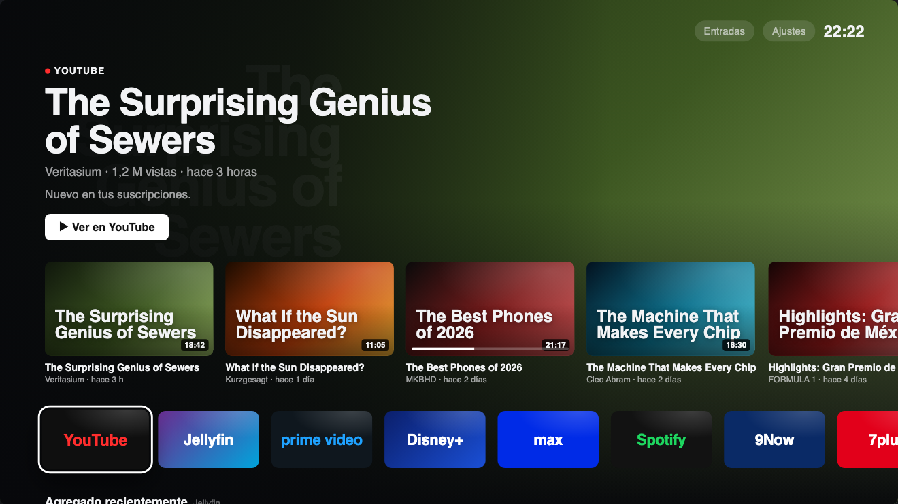

<p align="center">
  
</p>

<p align="center"><b>Un launcher propio para una Google TV, sin bloatware.</b><br>
Jellyfin y YouTube al frente, fijados para Prime Video, Disney+ y Max, y un control remoto en el iPhone y en la Mac.</p>

---

*Hollywood* es la tele del living: una FFALCON 75" U65 (TCL G10) con Google TV sobre Android 12, 32 bits
y 1,8 GB de RAM. El launcher de Google, el salvapantallas, el Asistente y los servicios de TCL se comen
unos 300 MB de esa memoria y llenan la pantalla de publicidad. Este repo tiene todo para reemplazarlos.

| | |
|---|---|
| `apps/tv/` | **Hollywood**, el launcher (Kotlin + Jetpack Compose for TV) |
| `apps/ios/` | Control remoto para iPhone y para la barra de menú de la Mac (SwiftUI) |
| `debloat/` | Qué se desactiva en la tele, en dos fases, sin root y reversible |
| `tools/` | `tv` (adb a la tele a través del servidor de casa) y `debloat.sh` (aplicar / restaurar) |
| `docs/` | La tele, la limpieza, el diseño del launcher y de la app, mockups |
| `design/` | El ícono «H▶» y su generador |

<p align="center"></p>

## El launcher

- **Arriba, lo que estás mirando:** imagen de fondo, título, sinopsis y progreso de lo enfocado; sin tocar
  el control, recorre sola la fila. Arriba a la derecha, el clima y la hora.
- **El contenido de cada app:** al enfocar Jellyfin aparece lo que está en curso y el próximo
  episodio. En YouTube, los videos nuevos de tus suscripciones. En Prime Video, Disney+ y Max, lo que
  fijaste.
- **Detalle de películas y series**, como el de Jellyfin: continuar, desde el principio, tráiler, reparto
  o episodios, y de dónde se reproduce.
- **Debajo de las apps:** lo último agregado a Jellyfin, más videos de YouTube, todos los fijados y la
  fila «Tele» (PlayStation 5, Entradas, Ajustes, Salvapantallas, Reiniciar).
- **Salvapantallas** con películas al azar de Jellyfin: fondo, póster, título y sinopsis.
- **Si el servidor de Jellyfin está apagado**, sigue mostrando lo último que cargó.
- **Botones del control:** Netflix, TCL Channel y compañía pueden abrir otras apps.
- **Configuración desde el celular:** el launcher sirve una página en la red de casa
  (`http://<ip-de-la-tele>:8765`, con el código que muestra la tele en Todas las apps → Configuración
  del inicio) para conectar Jellyfin y YouTube, cargar claves, elegir la ciudad del clima, fijar series y
  asignar botones. Ninguna clave vive en el código.

Prime Video, Disney+ y Max no dejan que otra app lea su "seguir viendo" (Android lo reserva a apps de
sistema), así que ahí se fija a mano: la imagen y la sinopsis salen de TMDB y el link, del botón
Compartir de cada app. Los detalles, en [docs/launcher.md](docs/launcher.md).

## Cómo se arma

Todo se compila en una Mac. No hay CI.

```bash
make tv-emulator      # emulador de Google TV con Android 12, el sistema de la tele
make tv-run           # compila e instala el launcher en el emulador
make tv-screenshot    # captura del emulador
make ios-build        # genera el proyecto de Xcode y compila para el simulador
make mac-run          # compila y abre el control de la barra de menú de la Mac

tools/debloat.sh status debloat/hollywood.txt   # estado de los paquetes en la tele
```

Requisitos: Android Studio (su JDK y el SDK, con la imagen `google-tv` de API 31) y, para las apps de
iPhone y Mac, Xcode y XcodeGen.

## Documentos

- [La tele](docs/tele.md): ficha, apps, links directos, entradas, control.
- [Limpieza](docs/limpieza.md): qué se desactiva, por qué y cómo se vuelve atrás.
- [Launcher](docs/launcher.md): diseño, configuración, YouTube, fijados, estado.
- [iPhone](docs/ios.md): control remoto por el protocolo de Google TV.
- [Mockups](docs/mockups/): los layouts que se evaluaron (abrir en el navegador; flechas para navegar).

## Créditos

La lista de limpieza parte de [cleanyourtv](https://github.com/Gathin23/cleanyourtv). La reproducción
de Jellyfin la hace [Wholphin](https://github.com/damontecres/Wholphin). El ícono es de la misma
familia que el de Ginebra, el servidor de casa.

## Licencia

[MIT](LICENSE).
